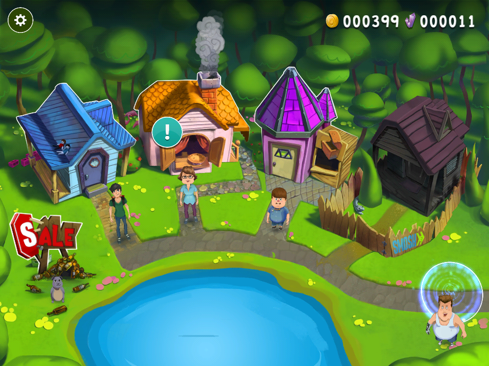
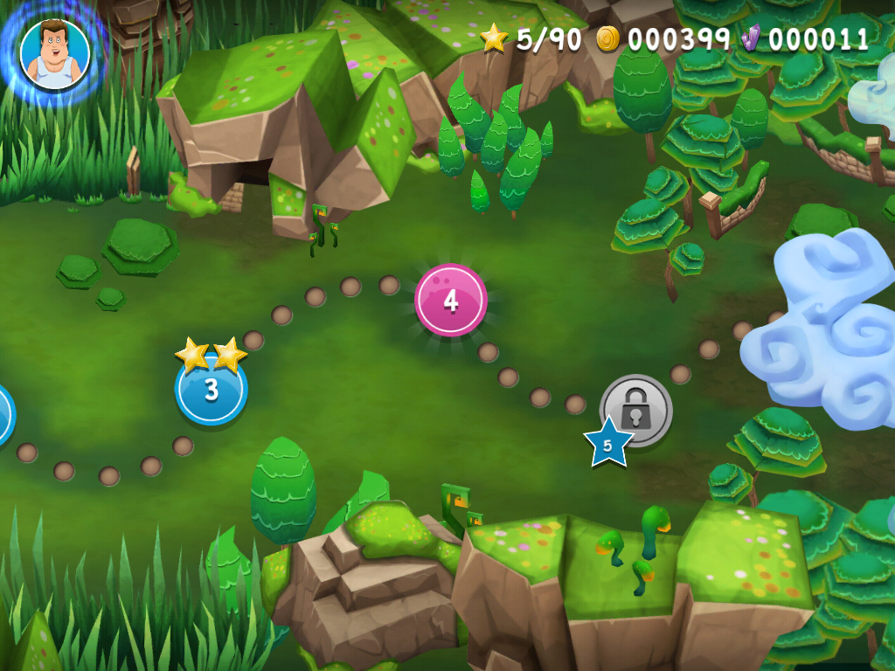
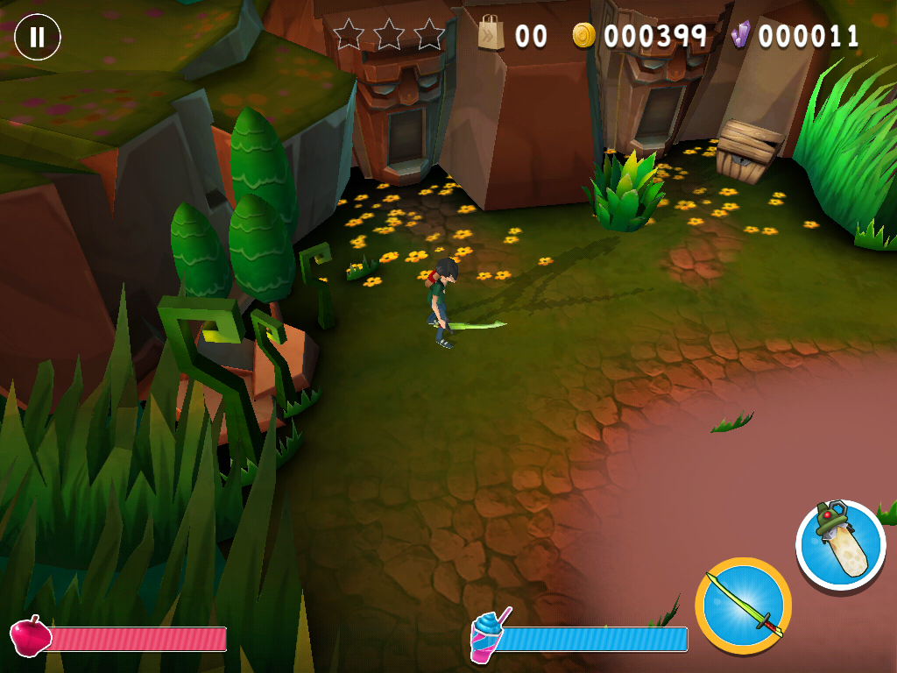
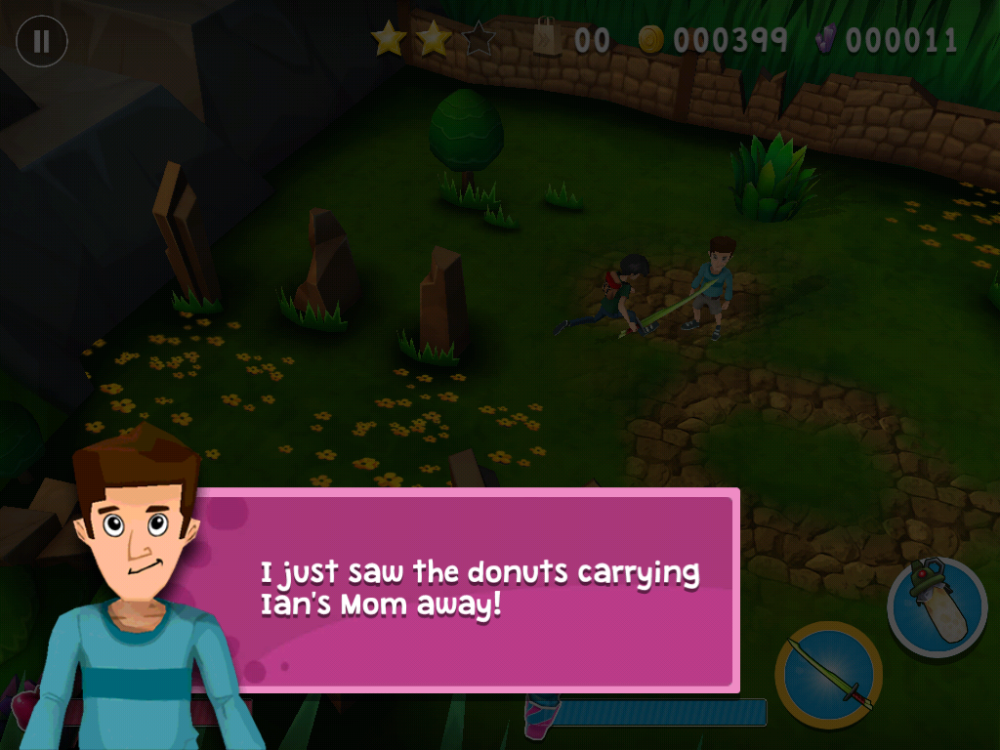
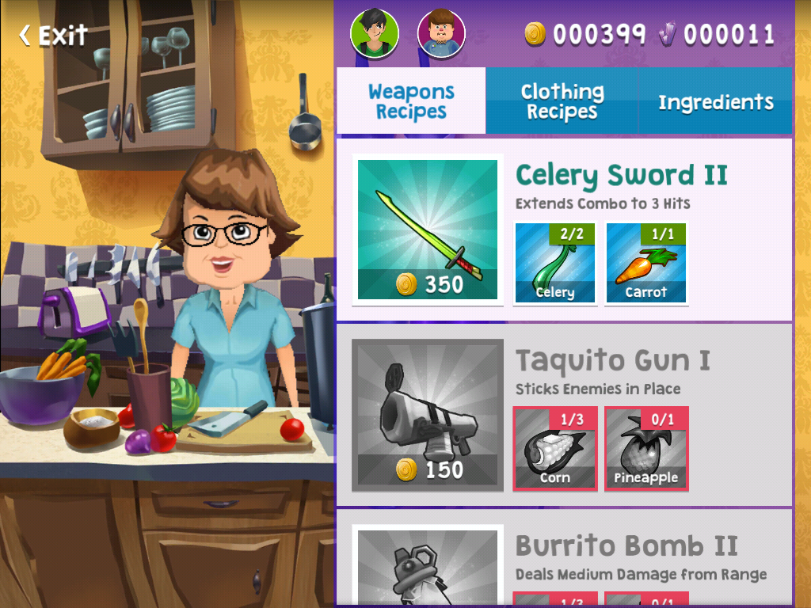
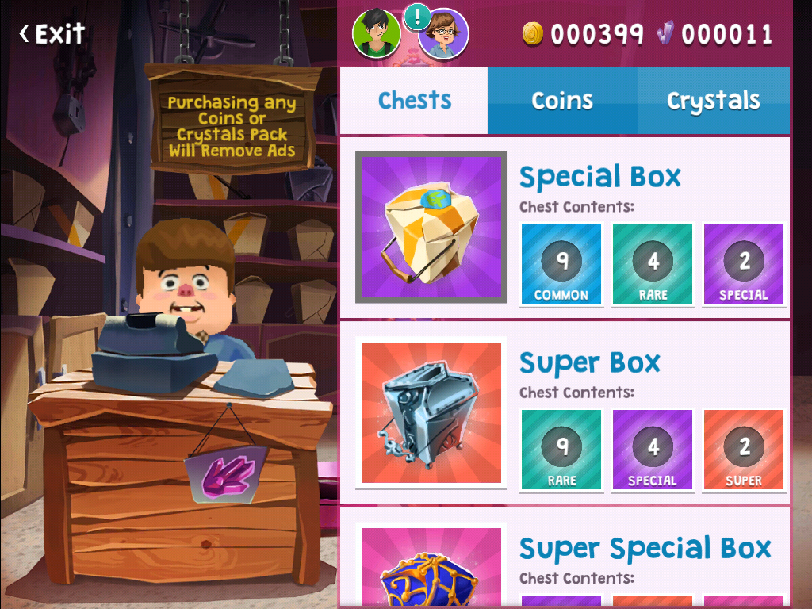

# 🍩 Food Battle Offline

**A fan preservation project that makes _Smosh: Food Battle The Game_ (2014) fully playable again — no servers required.**

-blue)

[Features](#-features) •
[Compatibility](#-compatibility) •
[Install](#-installing) •
[What doesn't work](#-what-doesnt-work) •
[How it works](#-how-it-works) •
[FAQ](docs/FAQ.md)

> [!IMPORTANT]
> **This repository does not contain the game.** It contains documentation and the
> patch tooling only. _Smosh: Food Battle The Game_ is copyrighted by its owners;
> see the [disclaimer](#%EF%B8%8F-disclaimer).

---

## 📖 About

When the official servers for _Smosh: Food Battle The Game_ were shut down, the
Android version stopped working entirely: it hung on the loading screen, then —
once that was worked around — wiped the player's progress on every scene change,
never saved, crashed when leaving buildings, and locked Challenge Mode forever.

This project documents every one of those problems and fixes them by patching
the game's own code so that it runs **completely offline**, exactly as it did
when it was released: the full story, all six acts, crafting, pets, shops and
Challenge Mode.

The fixes are written directly into the game's code (no runtime injection, no
root, no PC needed to play), and every fix uses the game's **own** built-in
offline behaviour wherever one exists.

## 📸 Screenshots

| Village hub | World map | Gameplay |
|:---:|:---:|:---:|
|  |  |  |
| **Story dialogue** | **Kitchen (crafting)** | **Shop** |
|  |  |  |

## ✨ Features

- ✅ **Boots straight to the game** — no server login, health check or hang
- ✅ **Full story** — all 30 levels across 6 acts, with all story dialogue in English
- ✅ **Saving works** — progress, coins, crystals, items, pets and story unlocks
- ✅ **Starting kit restored** — Celery Sword, clothing, 250 coins, 5 crystals
- ✅ **Crafting** in the kitchen, **equipment & clothing** in Ian's room
- ✅ **Shops** — Charlie's chests and the raccoon's shop (in-game currency)
- ✅ **Pets** — buy, equip, feed and level up; pets fight alongside you
- ✅ **Challenge Mode** — energy works offline (always full)
- ✅ **No ads**, and no freezes waiting for the ad server
- ✅ **Local reminder notifications** work again
- ✅ **Self-contained APK** — the expansion (OBB) data is merged in; nothing else to copy

## 📱 Compatibility

| Device | Status |
|---|---|
| Android phones & tablets (~2015–2022) | ✅ Tested — works |
| Android 5 – 15 | ✅ Should work (newer Android shows an "older app" warning — install anyway) |
| **BlueStacks 5** (PC) | ✅ Tested — works |
| LDPlayer 9 / MEmu / Nox (PC) | 🟡 Should work (same ARM translation as BlueStacks), not yet tested |
| Android Studio emulator | ❌ Does not work (its ARM translator can't run the game's engine) |
| 64-bit-only phones (Pixel 7 and newer, Galaxy S24/S25 and other recent flagships) | ❌ Cannot run 32-bit apps |
| iPhone / iPad | ❌ Android only — see [why](docs/FAQ.md#can-it-run-on-iphone-or-ipad) |

**Easy test:** try installing it. If your device can't run it, Android says
**"App not installed"** and nothing is harmed.

Full details: **[docs/COMPATIBILITY.md](docs/COMPATIBILITY.md)**

## 📥 Installing

| Where | Guide |
|---|---|
| Android phone or tablet | **[docs/INSTALL-ANDROID.md](docs/INSTALL-ANDROID.md)** |
| PC (BlueStacks, LDPlayer, MEmu, Nox) | **[docs/INSTALL-EMULATORS.md](docs/INSTALL-EMULATORS.md)** |
| Something went wrong | **[docs/TROUBLESHOOTING.md](docs/TROUBLESHOOTING.md)** |

**Quick version (Android):**
1. Get the patched APK onto your device.
2. Tap it → allow **Install unknown apps** if asked → **Install** (tap **Install anyway** on any warning).
3. Open **Food Battle**. The very first launch can show a black screen for up to a minute — wait.
4. Tap the **raccoon by the pond** (or the **Fat Guy** button) to open the level map.

> The patched APK is **not** distributed through this repository. To build it
> from your own copy of the game, see **[docs/BUILDING.md](docs/BUILDING.md)**.

## 🚫 What doesn't work

These features depended on the original servers or Google Play billing and
cannot be restored. They now show the game's own **"Offline"** / **"not
connected"** messages instead of breaking:

- Buying coins or crystals with real money
- Friends, accounts, and Facebook login
- Promo / redeem codes
- Restore purchases

Everything else works offline.

## 🔧 How it works

The game is a Unity 4.6 / Mono build. Its main code (`Assembly-CSharp.dll`) is
shipped encrypted and decrypted at launch by a small native library. This
project:

1. Ships the game code **already decrypted**, so the decryptor is no longer needed.
2. Writes **36 targeted patches** directly into the game's .NET IL code
   (see [`patches/fixes.js`](patches/fixes.js)).
3. Merges the 58 MB expansion file into the APK and turns Unity's OBB mode off.
4. Raises `targetSdkVersion` to 23 so Android 14+ will install it, and removes
   the x86 engine libraries so PC emulators use their ARM translator.

The interesting part is **finding** the bugs — the full write-up of every
problem and fix is in **[docs/TECHNICAL.md](docs/TECHNICAL.md)**.

## 📚 Documentation

| Document | Contents |
|---|---|
| [INSTALL-ANDROID.md](docs/INSTALL-ANDROID.md) | Installing on phones and tablets |
| [INSTALL-EMULATORS.md](docs/INSTALL-EMULATORS.md) | BlueStacks, LDPlayer, MEmu, Nox — requirements and setup |
| [COMPATIBILITY.md](docs/COMPATIBILITY.md) | Which devices work and why |
| [TROUBLESHOOTING.md](docs/TROUBLESHOOTING.md) | Black screens, install errors, saves |
| [FAQ.md](docs/FAQ.md) | iOS, saves, updates, consoles and more |
| [TECHNICAL.md](docs/TECHNICAL.md) | Every bug found and how each fix works |
| [BUILDING.md](docs/BUILDING.md) | Building the patched APK from your own copy |
| [CHANGELOG.md](CHANGELOG.md) | Version history |

## 🙏 Credits

- **Smosh** (Ian Hecox & Anthony Padilla), **Defy Media** and **Roadhouse
  Interactive** — for making the game in the first place.
- Built with [Frida](https://frida.re), [apktool](https://apktool.org),
  [ILSpy](https://github.com/icsharpcode/ILSpy) and
  [dnfile](https://github.com/malwarefrank/dnfile).

## ⚖️ Disclaimer

This is an **unofficial fan preservation project**. It is **not affiliated
with, endorsed by, or sponsored by** Smosh, Defy Media, Roadhouse Interactive or
any rights holder.

_Smosh: Food Battle The Game_ and all of its content (code, art, audio, video
and text) belong to their respective owners. **This repository does not
contain or distribute the game or any part of it** — only original
documentation and tooling, released under the [MIT license](LICENSE). If you
are a rights holder and have concerns, please open an issue.
